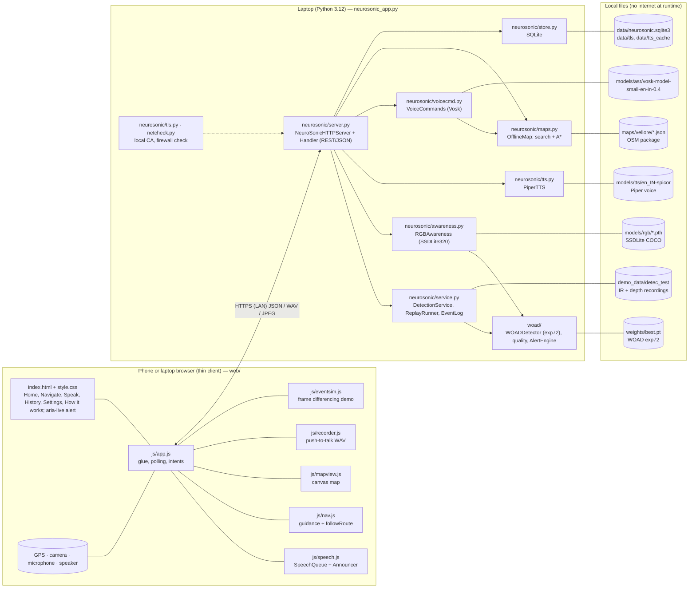
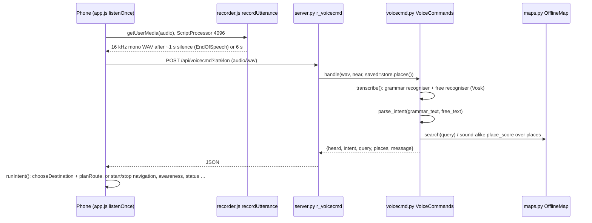
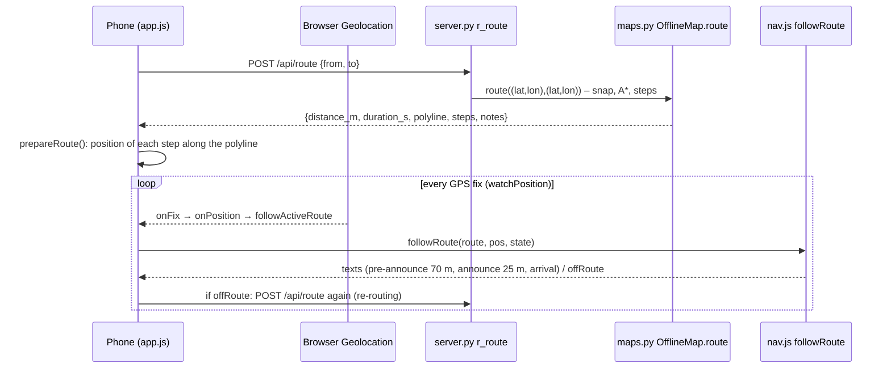

# 2. System architecture

## 2.1 Deployment view



* **Who computes what:**
  * Everything inside **Laptop** runs on the laptop's CPU.
  * The phone runs JavaScript only: UI, queueing, geometry for route following, and the 160×120 frame
    differencing of the event simulation.
* **Network:** the phone reaches the laptop over the local Wi-Fi with HTTPS (`neurosonic/tls.py`). No request
  goes to the internet, apart from the optional "Open in OpenStreetMap" link.

## 2.2 Start-up sequence (`neurosonic_app.py::main`, L28–139)

1. **Parse the command line:** `--host`, `--port`, `--https`, `--voice-model`, `--map`, `--asr-model`,
   `--rgb-weights`, `--db`, …
2. **If `--https`:** `tls.ensure_certificates()` creates or refreshes the local CA and server certificate, and
   `tls.server_ssl_context()` builds the SSL context.
3. **Open the database:** `Store(db)` creates or opens SQLite.
4. **Load WOAD:** `DetectionService(store, weights, device)` loads the WOAD checkpoint with a hash check
   (`woad/model_loader.py::load_model`).
5. **Load the voice:** `PiperTTS(...).warm_up()` loads the Piper voice and synthesises "Ready.".
6. **Load the map:** `OfflineMap(maps/vellore)` reads the graph and places and computes connected components.
7. **Load speech recognition:** `VoiceCommands(...).warm_up()` loads the Vosk model.
8. **Load the camera detector:** `RGBAwareness(...).warm_up()` loads SSDLite and runs one blank frame.
9. **Start serving:**
   * `make_server(...)` builds the `NeuroSonicHTTPServer`, with an exclusive port bind on Windows.
   * In HTTPS + LAN mode, `make_setup_server(...)` also serves the CA certificate over plain HTTP on port+1.
   * `windows_report(...)` prints firewall and network-profile warnings with the exact fix commands.
   * `serve_forever()` starts handling requests.

## 2.3 Main runtime flows

### Obstacle alert from the phone camera

```mermaid
sequenceDiagram
  participant P as Phone (app.js awarenessStep)
  participant S as server.py r_awareness_frame
  participant A as awareness.py RGBAwareness
  participant E as woad/alerts.py AlertEngine
  participant V as speech.js Announcer
  P->>P: every 400 ms draw video to 320 px canvas, toBlob JPEG q=0.7
  P->>S: POST /api/awareness/frame?session&mode (image/jpeg)
  S->>A: process_frame(jpeg, session, mode)
  A->>A: quality() brightness check; detect() SSDLite, keep obstacle classes, score>=0.40
  A->>E: process(time, detections, quality, image_width, image_height)
  E-->>A: events (2-of-3 confirmed, positioned, cooled down)
  A-->>S: {detections, events[urgent flag], quality, inference_ms}
  S-->>P: JSON
  P->>V: say(text, "urgent"|"obstacle"|"system", position)
  V->>S: GET /api/tts?text=… (Piper WAV, cached)
  V->>V: play in <audio>; urgent interrupts navigation speech
```

### Voice command



### Walking navigation



## 2.4 Design decisions (and why)

| Decision | Reason | Trade-off |
|---|---|---|
| Python standard-library HTTP server (`http.server`), no web framework | no extra dependencies; full control of TLS handshakes and byte ranges; easy to read in a viva | fewer conveniences (manual routing tables `GET`/`POST` in `server.py` L392–402) |
| Heavy models on the laptop, browser on the phone | WOAD, Piper, Vosk and SSDLite run in Python/PyTorch/ONNX on the laptop; one code base serves iPhone, Android and laptop; no app-store build | the phone depends on the laptop and the Wi-Fi (not standalone) |
| Plain JavaScript ES modules, no framework or CDN | works offline, nothing to download, small | manual DOM code in `app.js` |
| Own A* router on an OSM extract instead of GraphHopper/Valhalla | no Java/C++ engine to install; whole algorithm visible in 22 lines (`maps.py` L184–205) | no pedestrian-specific costs (crossings, surfaces) |
| Canvas map renderer instead of map tiles | tiles need a tile server or a large download; canvas draws the 1 MB vector `map.json` | simpler styling, no labels |
| Piper + Vosk | both offline, both run on CPU, both have Indian-English models | AGPL voice licence; small ASR model mishears local names |
| SSDLite320-MobileNetV3 for RGB | already part of the installed torchvision; 3.4 M parameters, ~45 ms per frame on CPU | low accuracy (COCO box mAP 21.3) |
| Re-use of the WOAD alert engine for every alert source | one tested implementation of confirmation, positions, cooldowns and availability messages | WOAD-oriented naming in `woad/alerts.py` |

## 2.5 Source tree (application parts)

```
implementation/
  neurosonic_app.py        start-up (server + all engines)
  neurosonic/              server.py, service.py, store.py, tts.py, voicecmd.py, maps.py, awareness.py, tls.py, netcheck.py
  woad/                    WOAD inference: arch/, model_loader.py, preprocess.py, ops.py, detector.py,
                           alerts.py, quality.py, sources.py, replay.py, pairing.py, metrics.py, visualize.py
  web/                     index.html, style.css, js/{app,speech,nav,mapview,recorder,eventsim}.js
  tools/                   build_offline_map.py, evaluate.py, verify_equivalence.py, make_e2e_media.py, …
  tests/                   Python unittest suite + tests/js (Node unit tests, browser E2E scripts)
  models/  maps/  weights/  demo_data/  data/   (models, map package, checkpoint, demo recordings, runtime data)
  docs/                    engineering notes (EVALUATION, FEATURE_STATUS, roadmap, app guide)
```
