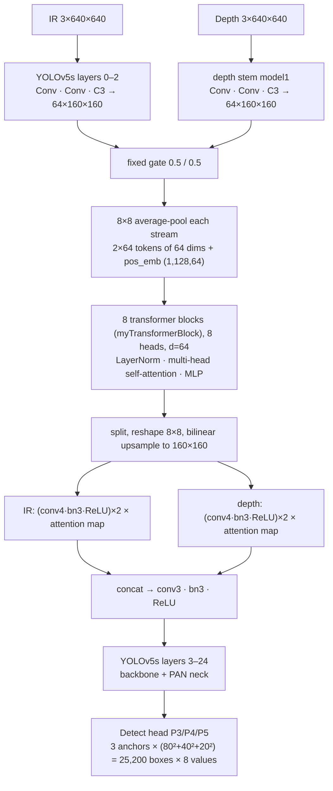

# 9. The original WOAD model: architecture, inputs, classes and limitations

## 9.1 Origin

* **What it is:** WOAD is the research foundation of the project ("A Wearable Obstacle Avoidance Device for
  Visually Impaired Individuals with Cross-Modal Learning"). The original code is in
  `F:\Projects\WOAD-Research\original\Cross-Modal obstacle detection\` and is **unchanged**.
* **The checkpoint used:** `runs/train/exp72/weights/best.pt`, copied to `implementation/weights/best.pt`.
  * SHA-256 `da043ff2e1edd393fcd329dddbac58676f1305c14f2eb084f928439d7950f8aa`, verified at every load;
  * 7,521,992 parameters; saved 2023-04-05; optimizer stripped.
* **Other checkpoint in the repository:** the root `best.pt` is a different, incompatible 5-class variant and
  is refused by `load_model` with a clear error.

## 9.2 Inputs

| Stream | Content | Preprocessing (`woad/preprocess.py`) |
|---|---|---|
| IR ("x") | near-infrared frame of the Synexens CS30 RGB-ToF sensor, 640×480, 8-bit grey (read as 3 channels) | resize the long side to 640 (`preprocess_ir` L62–69), letterbox to 640×640 (pad 114) |
| depth ("cloud") | depth image **colour-mapped by the Synexens SDK** (`apply_colormap`), 640×480, 3-channel | `medianBlur(3)` + letterbox (`preprocess_depth` L72–75) |

* Both: BGR→RGB, CHW, float /255 → tensors (1, 3, 640, 640).
* The forward call is `model(ir, depth)` (`woad/detector.py::raw_forward` L45–47).
* The input size is fixed at 640, because the depth branch was letterboxed to a hard-coded 640 during training.

## 9.3 Architecture (`woad/arch/yolo.py::Model._forward_once`, L165–223)



* **Two streams.** The IR image goes through the first three YOLOv5s layers. The depth image goes through its
  own small stem (`model1`), giving two feature maps of 64×160×160.
* **Fusion at layer 2** (L175–222): both maps are scaled by a fixed 0.5/0.5 gate.
  1. Each is **average-pooled to 8×8** (`self.avp`), giving 64 tokens per stream, 128 tokens in total, each a
     64-dimensional vector.
  2. A learned **positional embedding** is added.
  3. The tokens pass through the **transformer blocks** (`myTransformerBlock` L85–103: LayerNorm →
     multi-head self-attention `SelfAttention` L106–148 → residual → LayerNorm → MLP with GELU → residual),
     then a final LayerNorm.
  4. The output tokens are split back per stream, reshaped to 8×8, upsampled bilinearly, and used to
     **multiply** (re-weight) each stream's convolved features.
  5. The two streams are concatenated and reduced by `conv3`.

  Self-attention lets every IR token attend to every depth token and vice versa: this is the *cross-modal*
  learning.
* **Rest of the network:** the standard YOLOv5s backbone and PAN neck, then the `Detect` head (L37–82). The head
  outputs (B, 25,200, 8): x, y, w, h, objectness and 3 class scores.
* **Post-processing:** `woad/ops.py::non_max_suppression` (L74–158), then `scale_coords` (L161–174) back to the
  original IR pixels.

Excerpt of the attention (`SelfAttention.forward`, L134–143):

```python
q = self.que_proj(x).view(b_s, nq, self.h, self.d_k).permute(0, 2, 1, 3)
k = self.key_proj(x).view(b_s, nk, self.h, self.d_k).permute(0, 2, 3, 1)
v = self.val_proj(x).view(b_s, nk, self.h, self.d_v).permute(0, 2, 1, 3)
att = torch.matmul(q, k) / np.sqrt(self.d_k)
...
att = torch.softmax(att, -1)
```

**Dimensions verified on the loaded checkpoint (2026-11-02):**

* `trans_blocks`: **8** blocks, **8 heads**, d_model **64**;
* `pos_emb` shape **(1, 128, 64)**;
* `avp` = `AdaptiveAvgPool2d((8, 8))`;
* `model1` = [Conv, Conv, C3]; `model` has 25 layers;
* **7,521,992** parameters.

## 9.4 Classes

`[person, Ebike, Car]`, from the checkpoint (`EXPECTED_NAMES` in `woad/model_loader.py` L25).

## 9.5 Verification of the re-implementation

| Check | Result | Evidence |
|---|---|---|
| Same outputs as the original code | maximum absolute difference **0.0** at output shape (2, 25200, 8) | `tools/verify_equivalence.py` runs the original `models/yolo.py` in a subprocess |
| Input order matters (IR, depth) | swapping the streams leaves 8 % of the detection confidence | `tests/test_detection.py` |
| Both modalities are used | blank IR → 0 %; blank depth → 65 % of the confidence remains (IR dominant) | `tests/test_detection.py` |
| Preprocessing faithful | mutations (no median blur, no BGR→RGB, swapped inputs) each fail ≥ 2 tests | mutation runs |
| Speed | about 100–130 ms per forward pass on the laptop CPU | CLI/evaluation timings |

## 9.6 Evaluation (`tools/evaluate.py`, `docs/EVALUATION.md`)

* **The authors' figures:** mAP@0.5 = **0.669** (person 0.771, Ebike 0.839, Car 0.395), read from a training
  plot (`PR_curve.png`).
* **They cannot be reproduced:** the published dataset (`VOCdetiv_data.rar`, verified) has different classes
  (person / box / bike / doors / poles …) and contains none of exp72's 187 validation frames.
* **What was measured:** person-only, cross-dataset, with the original metric code (verified equal to the
  original `ap_per_class`):
  * **AP@0.5 = 0.218** on the val split (365 images, 129 people);
  * **AP@0.5 = 0.173** on the train split (1,286 images, 458 people).
  * The model is precise but has low recall here: it misses cyclists and distant people.
* **IR brightness experiment** (`experiments/ir_brightness_test.py`): darkening training-like frames to a raw
  CS30 recording's brightness removes about 73 % of detections. Histogram correction does not fix the real dark
  recording: 1 correct detection against 56 false alarms. That is why `woad/quality.py` blocks dark input.

## 9.7 Limitations

* Only 3 classes. It needs the CS30 sensor, which is not connected, so the app uses **recorded** IR + depth
  (`demo_data/detec_test`) for WOAD.
* Accuracy on new scenes is low (person AP@0.5 ≈ 0.17–0.22, cross-dataset). The authors' numbers are
  unverified.
* No distance output, although the depth stream exists. Metric distance would need the raw 16-bit depth.
