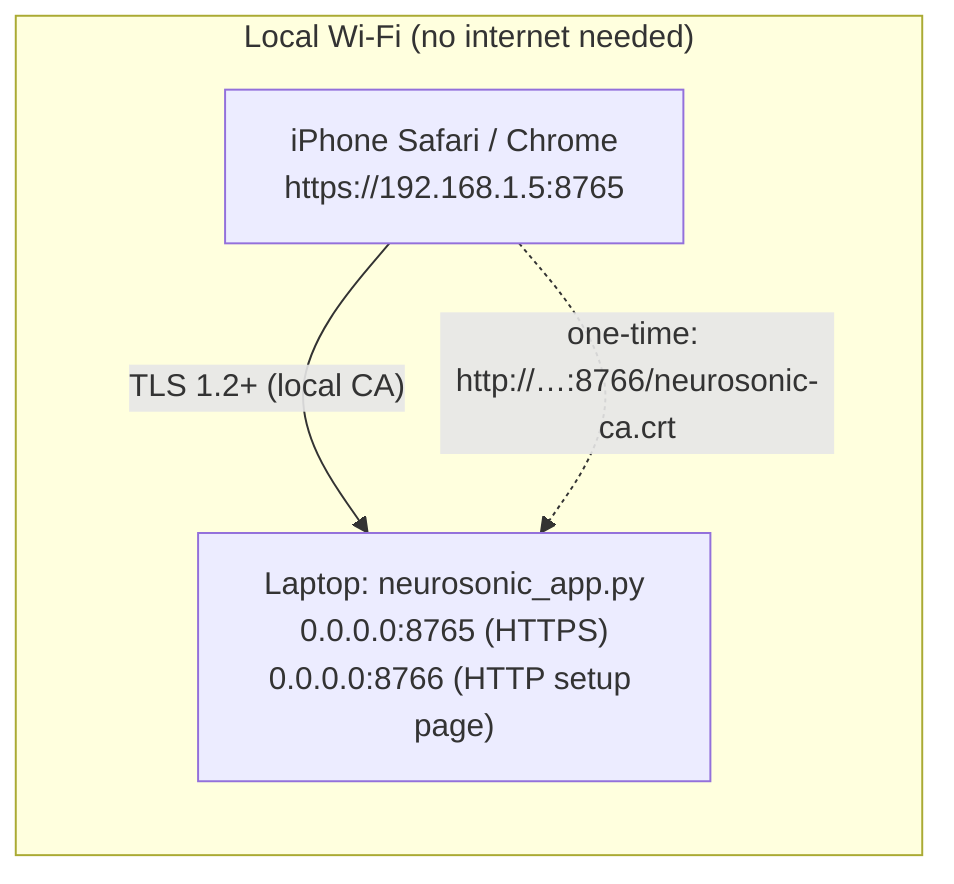

# 12. HTTPS, local network and iPhone connection architecture

## 12.1 The honest summary

* **The iPhone is a browser client of the laptop.** It does **not** run the models. TTS, speech recognition,
  WOAD, SSDLite, routing and the database all run on the laptop.
* **"Offline" means "no internet required".** The phone needs a **local Wi-Fi connection to the laptop**: the
  same Wi-Fi, a phone hotspot, or a router without internet.
* **If the laptop is unreachable:**
  * the page reports "Obstacle detection unavailable: app server not reachable" (`app.js::pollEvents`
    L88–104);
  * only the phone's built-in voice and the already-loaded page remain;
  * no new routes, recognition or detection are possible.
* **Not physically verified:** iPhone playback, microphone and camera with this architecture have **not** been
  physically confirmed (acceptance tests A1, V1 and C1 are pending).

## 12.2 Why HTTPS is required

Browsers only grant **camera, microphone and geolocation** to *secure contexts* (HTTPS pages, or `localhost`).
A phone opening `http://192.168.1.5:8765` would load the page, but GPS, camera and microphone would be refused.
The code checks for this: `window.isSecureContext` (`app.js` L140) and `recorder.js` L67.

## 12.3 Local certificate authority: `neurosonic/tls.py`

Public certificate authorities cannot issue certificates for a private IP such as 192.168.1.5, and a plain
self-signed certificate is rejected by iOS. NeuroSonic therefore creates **its own small certificate authority**
(the same approach as the `mkcert` tool), using the `openssl` command-line program.

| Step | Code | Detail |
|---|---|---|
| 1. CA | `ensure_certificates` L86–130 | "NeuroSonic Local CA", RSA 2048, 825 days, `basicConstraints=CA:TRUE, pathlen:0`, `keyUsage=keyCertSign,cRLSign` |
| 2. Server certificate | same | signed by the CA; **subjectAltName** = all LAN IPs (`lan_ips` L36–55) + 127.0.0.1 + localhost + host name; `extendedKeyUsage=serverAuth`; `CA:FALSE`; 397 days; SHA-256 |
| 3. Renewal | same | re-issued automatically when the LAN IP changes or < 14 days remain; the CA is kept, so the phone stays set up |
| 4. Context | `server_ssl_context` L133–137 | `PROTOCOL_TLS_SERVER`, minimum TLS 1.2 |

**Why these extensions matter:** since iOS 13, Apple requires TLS server certificates to name the host in
subjectAltName and to carry the serverAuth usage. The first version of the app had a Common-Name-only
certificate, which iOS rejects. That was diagnosed and fixed, and is covered by
`tests/test_mobile_access.py::TestCertificates`.

### Phone setup (one time)

* The laptop runs a second, **plain-HTTP** server on port+1 (`server.py::make_setup_server` L469–506). It serves
  only a setup page and `neurosonic-ca.crt`.
* On the iPhone, in Safari:
  1. open `http://<laptop-ip>:8766` and download the certificate;
  2. Settings → General → VPN & Device Management → install;
  3. Settings → General → About → Certificate Trust Settings → enable full trust;
  4. check that the SHA-256 fingerprint matches the one printed by the laptop. This protects against a
     substituted certificate on the open setup page.

## 12.4 Server robustness for phones: `neurosonic/server.py::NeuroSonicHTTPServer` (L421–459)

| Problem found | Fix | Test |
|---|---|---|
| The TLS handshake ran in `accept()` on the main thread, so one idle connection froze all clients (reproduced: requests hung 8 s) | the handshake runs per connection in the worker thread, with a 10 s timeout (`finish_request` L444–459); idle requests time out after 60 s | `test_idle_connection_does_not_block_other_clients` (fails on the old design) |
| Windows `SO_REUSEADDR` let a second NeuroSonic silently share the port, so a stale instance answered requests (new endpoints returned 404) | exclusive bind (`SO_EXCLUSIVEADDRUSE`, `server_bind` L435–438); a second start fails with "is the app already running?" | `test_second_instance_cannot_share_the_port` |
| Windows' `mimetypes` can map `.js` to `text/plain`, and browsers then refuse ES modules | explicit `STATIC_TYPES` (L49) | `test_mime_types_of_every_page_asset` |
| iOS fetches audio in byte ranges | HTTP Range support (`_send_media` L255–272) | `test_tts_endpoint_and_ranges` |

## 12.5 Firewall: `neurosonic/netcheck.py`

* **The problem:** Windows blocks incoming connections on **Public** networks unless a rule allows them. The
  laptop still works, because it connects to itself, but the phone just spins. This was the original "iPhone
  stays loading" cause.
* **The check:** `windows_report` (L24–57) **only reads** the network category (`Get-NetConnectionProfile`) and
  looks for a rule named "NeuroSonic LAN" (`netsh`).
* **The fix:** it prints the exact administrator commands, for example
  `New-NetFirewallRule -DisplayName "NeuroSonic LAN" … -LocalPort 8765,8766 -RemoteAddress LocalSubnet -Profile Private`.
  It never changes the firewall itself.

## 12.6 iOS-specific client measures

* **Audio unlock** (`speech.js::unlock` L118–135), run inside the first tap:
  * set the audio session to "playback";
  * resume WebAudio;
  * play a silent WAV on the reusable `<audio>` element;
  * speak an empty utterance.
* **No layout shift during a tap.** The header and alert banner have fixed heights. A layout shift between press
  and release had swallowed the first "Test Voice" tap; this was found by the browser E2E test.
* **No `??` or `?.` syntax**, so older iOS WebKit can parse the scripts
  (`test_no_optional_chaining_or_nullish_operators`).
* **Microphone:** a `ScriptProcessorNode`, which iOS supports.
* **Camera:** `playsinline`, rear camera `facingMode: "environment"`.

## 12.7 Security considerations

* **No login:** anyone on the same network can use the API. Use it only on a trusted network; the start-up
  warning says so.
* **Private keys:** `data/tls/neurosonic-ca.key` can sign certificates that the configured phone will trust.
  Keep `data/` private, and remove the profile from the phone when it is no longer needed.
* **Untrusted pickles:** the WOAD checkpoint load uses `weights_only=False`, so only the hash-verified file is
  loaded by default (`model_loader.py` L91–99).
