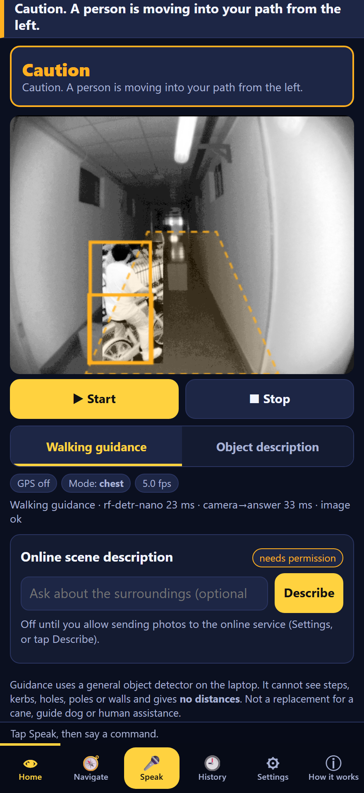
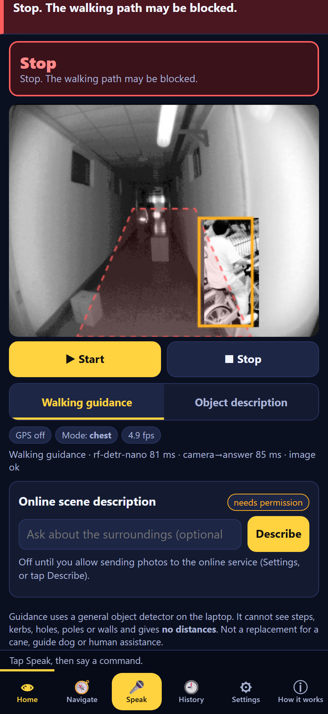
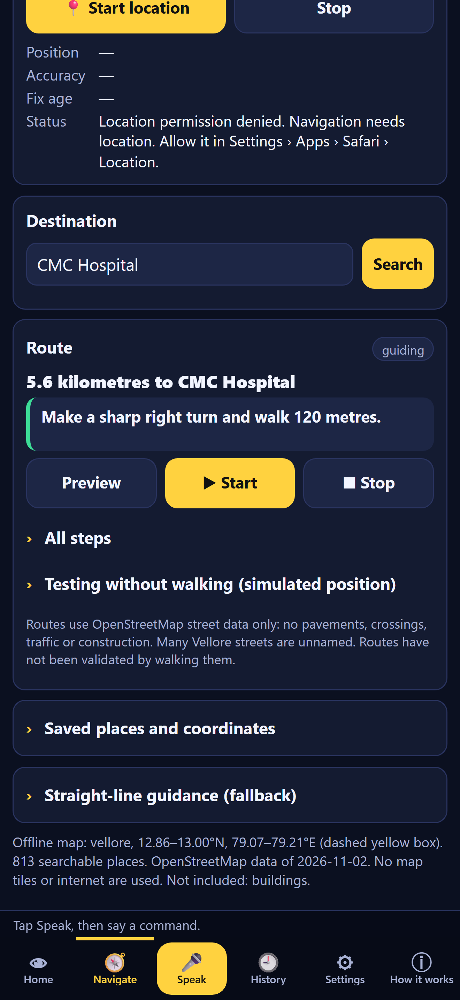
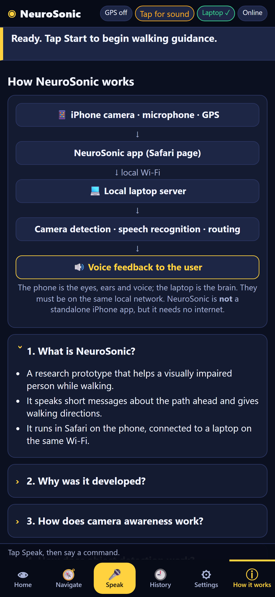

# NeuroSonic: final technical documentation

* **Status date:** 2026-11-03.
* **What NeuroSonic is:** an assistive **research prototype** for visually impaired pedestrians.
* **Safety:** it is **not** a safety device and **not** a replacement for a cane, guide dog or human assistance. No
  part of this document claims that NeuroSonic makes navigation safe.

---

## 1. Summary

NeuroSonic turns an iPhone into the eyes, ears and voice of a perception system that runs on a laptop.

| Capability | How | Needs internet |
|---|---|---|
| **Walking guidance from the camera** | detector → walking-path assessment → short spoken states ("Caution…", "Stop…", "appears clear") | no |
| **Event alerts** (new in this phase) | RF-DETR Nano on the GPU → ByteTrack-style tracking with camera-motion compensation → "Caution. A person is moving into your path from the left." / "A bicycle is crossing in front of you, from left to right." | no |
| **Object description** (optional mode) | object names with left / centre / right | no |
| **Neural voice** | Piper (Indian English) on the laptop | no |
| **Voice commands** | Vosk (Indian English) on the laptop | no |
| **Offline map, routing, GPS guidance** | OpenStreetMap extract of Vellore, A* routing, turn instructions, off-route handling | no |
| **Online scene description** (optional, opt-in) | one photo → Gemini (`gemini-3.8-flash`) → "AI description: …" | yes |
| **WOAD research detector** | original near-IR + depth model, on recorded data | no |

The phone depends on the laptop over the local Wi-Fi. It is **not** a standalone iPhone app.

---

## 2. Architecture

```
iPhone (Safari, web/)                                  Laptop (neurosonic_app.py, Python 3.12)
  camera ── 320 px JPEG every 200 ms* ───────────────► POST /api/awareness/frame
  (one request in flight, paused when hidden)            neurosonic/awareness.py  RGBAwareness.process_frame
                                                           ├─ quality + sharpness check
                                                           ├─ detector (neurosonic/detectors.py)
                                                           │    RF-DETR Nano on CUDA (.venv-gpu) ── fallback ─► SSDLite320 CPU
                                                           ├─ camera motion (neurosonic/tracking.py, LK optical flow, RANSAC)
                                                           ├─ ByteTrack-style tracker (neurosonic/tracking.py)
                                                           ├─ walking-path state (neurosonic/pathguide.py)
                                                           ├─ events: entering / crossing (neurosonic/events.py)
                                                           └─ object description (woad/alerts.py AlertEngine, optional)
  speaker ◄── spoken text (priority queue, web/js/speech.js) ◄── JSON events
          ◄── WAV ───────────────────────────────────── GET /api/tts (Piper)
  mic ───── WAV ─────────────────────────────────────► POST /api/voicecmd (Vosk)
  GPS ───── position (stays on the phone) ───────────► POST /api/route (A*, offline Vellore map)
  Describe ─ one photo (opt-in) ─────────────────────► POST /api/vision/describe → Gemini (internet)
                                                       SQLite history (text only, no images)
* 200 ms with the GPU detector, 400 ms with the CPU fallback (the laptop tells the phone: recommended_frame_ms)
```

### Runtime environments

| Environment | Use | Contents |
|---|---|---|
| `F:\Projects\WOAD-Research\.venv` (**production, unchanged**) | original app, CPU only | torch 2.15.0+cpu; the app automatically uses SSDLite (fallback reason shown at start-up) |
| `F:\Projects\WOAD-Research\.venv-gpu` (**recommended for the demo**) | GPU perception | torch 2.15.0+cu132, torchvision 0.29.1+cu132, rfdetr 1.11.2, all production packages at the same versions; 4.2 GB |

---

## 3. Module reference

| Module | Purpose | Key parts |
|---|---|---|
| `neurosonic_app.py` | start-up: loads every engine, prints their status, serves HTTP/HTTPS | `--detector auto\|rfdetr\|ssdlite`, `--no-events`, `--vision-provider`, `--host 0.0.0.0 --https` |
| `neurosonic/server.py` | standard-library HTTP(S) server and API (28 endpoints) | routing tables; per-connection TLS; drains unread request bodies before error responses |
| `neurosonic/detectors.py` (**new**) | detector back-ends and fallback | `RFDETRDetector` (CUDA, local weights only, 2 CPU threads), `SSDLiteDetector`, `FallbackDetector` (switches on a run-time failure and re-runs the frame), `make_detector` |
| `neurosonic/tracking.py` (**new**) | camera motion + tracking | `estimate_camera_motion` (Shi–Tomasi corners outside objects, pyramidal Lucas–Kanade, RANSAC similarity), `ByteTracker` (two-stage association, camera-compensated prediction, motion relative to the background) |
| `neurosonic/events.py` (**new**) | conservative temporal events | `PathEventDetector`: *entering* the walking path, *crossing* in front; camera-stability gate; once per track; 3 s gap; no "approaching" |
| `neurosonic/awareness.py` | per-frame pipeline and per-phone session state | `RGBAwareness.process_frame`, `_Session` (alert engine, path guide, tracker, events, last frame), `info()` (detector, fallback reason, frame interval, per-device counters) |
| `neurosonic/pathguide.py` | walking-path states | CLEAR_VIEW, POSSIBLE_OBSTACLE, BLOCKED_VIEW, UNCERTAIN, CAMERA_UNAVAILABLE; 2-of-3 / 3-of-3 confirmation |
| `woad/alerts.py` | object description wording, cooldowns, merging | `AlertEngine` |
| `neurosonic/tts.py` | Piper neural voice | cached WAV synthesis |
| `neurosonic/voicecmd.py` | Vosk voice commands | intents incl. describe / ask scene |
| `neurosonic/maps.py` | offline map, search, A* routing, turn steps | `OfflineMap.route` |
| `neurosonic/vision/` | online scene description (provider-independent) | `SceneAssistant`, `GeminiProvider`, `MockProvider` |
| `neurosonic/store.py` | SQLite history (text only) | alerts, places |
| `web/js/app.js` | phone client | camera loop with server-chosen interval and latency measurement, GPS, navigation, voice, settings |
| `web/js/speech.js` | spoken output | priority queue (urgent > system > obstacle > navigation/scene > info), cooldowns, interruption |
| `tools/benchmark_detectors.py` | Phase 1 benchmark | identical images for every detector |
| `tools/make_event_clip.py` | demo / test video | real recorded person on a bicycle composited over a real empty scene |

---

## 4. Perception pipeline (per frame)

1. **Phone:** draws the video into a 320 px canvas, encodes a JPEG (quality 0.7) and posts it. It records the capture
   time and measures capture → analysed answer.
2. **Quality:** brightness and contrast, plus sharpness (variance of the Laplacian). Unusable frames give UNCERTAIN.
3. **Detection:** RF-DETR Nano (COCO, 384 px, CUDA), restricted to 23 obstacle classes, confidence ≥ 0.40. If CUDA,
   the package or the weights are missing, or warm-up fails, SSDLite is used. If RF-DETR fails during live use, the
   app switches to SSDLite for good and re-analyses the same frame.
4. **Camera motion:** background corners outside the detected boxes are followed into the new frame, and a similarity
   transform is fitted (shift, scale; RANSAC). Too few corners means "unknown".
5. **Tracking:** ByteTrack-style. Confident detections (≥ 0.55) are matched first by IoU to each track's
   camera-predicted box, per class. Weaker detections (0.40–0.55) can only extend existing tracks. Tracks end after 3
   missed frames. Every update stores the object's displacement **relative to the background**.
6. **Walking-path state:** unchanged `pathguide.py` logic. The lower-central trapezoid is the path.
7. **Events** (conservative):
   * Tracks must be confirmed: ≥ 3 updates over ≥ 0.4 s, and only people, vehicles and animals.
   * Nothing is announced while the camera shifts > 6 % of the width per frame, zooms > 4 %, or has no estimate.
   * Nothing is announced in BLOCKED_VIEW, UNCERTAIN or CAMERA_UNAVAILABLE.
   * **Entering:** the object was outside the path region at the start of the last 1.5 s, overlaps it now, and moves
     towards it at ≥ 0.12 image widths per second (relative motion).
   * **Crossing:** the centre passes from < 35 % to > 65 % of the width (or back) within 3 s, at ≥ 0.15 widths per
     second, with the bottom of the object in the lower half of the image.
   * Each event is spoken once per track, with at least 3 s between events. The generic "Caution. An object is
     detected…" is suppressed for 2 s after the more specific "moving into your path" message.
8. **Speech:** events are spoken with the obstacle priority; "Stop" (BLOCKED_VIEW) stays urgent and can interrupt.
   The neural voice is used, with the device voice as fallback.

**Deliberately not done:**

* **"Approaching" alerts:** with a moving camera, box growth is dominated by the user's own walking, which would
  cause false alarms.
* **Depth and segmentation:** not added in this phase; see section 13.

---

## 5. Model selection (Phase 1, `docs/PHASE1_GPU_DETECTOR_BENCHMARK.md`)

The setup was identical for every detector: 365 near-infrared validation images with 129 people, scored with the
project's own AP code; 640 × 480 recorded frames; FP32.

| Detector | GPU latency | CPU latency | Person AP@0.5 | AP@0.5:0.95 | Recall @ 0.40 | Licence |
|---|---|---|---|---|---|---|
| SSDLite320 (previous) | 42.3 ms (no GPU gain) | 43.7 ms | 0.542 | 0.208 | 0.574 | BSD-3 |
| **RF-DETR Nano (selected)** | **21.3 ms** | 121.9 ms | **0.660** | **0.304** | **0.729** | **Apache-2.0** |
| YOLO26n | 12.4 ms | 27.8 ms | 0.619 | 0.268 | 0.628 | AGPL-3.0 |
| YOLO26s | 11.8 ms | 57.5 ms | 0.628 | 0.292 | 0.651 | AGPL-3.0 |

**Why RF-DETR Nano:**

* it had the highest accuracy and recall of the four;
* its Apache-2.0 licence has no source-release obligation (YOLO's AGPL would have one for a network service);
* it is fast enough on the RTX 4050 for a 200 ms frame interval;
* SSDLite stays as the CPU fallback, because RF-DETR is too slow on the CPU.

**Licences verified:** `rfdetr` Apache-2.0 (package metadata), `transformers` Apache-2.0, PyTorch BSD, COCO
annotations CC BY 4.0. The tracker is an own implementation of the published ByteTrack association idea.

---

## 6. What was implemented in this phase

| Change | Files |
|---|---|
| RF-DETR Nano as the primary GPU detector, with automatic fallback (start-up and run time) to SSDLite; local weights only, Hugging Face downloads blocked | `neurosonic/detectors.py` (new), `neurosonic/awareness.py` |
| CPU fix: PyTorch limited to 2 CPU threads while RF-DETR runs on the GPU (idle worker threads were busy-waiting); the default is restored on fallback | `neurosonic/detectors.py` |
| Camera-motion estimation + ByteTrack-style tracking | `neurosonic/tracking.py` (new) |
| Entering / crossing events, merged into the existing speech | `neurosonic/events.py` (new), `neurosonic/awareness.py` |
| Server-chosen frame interval (200 ms on GPU, 400 ms on CPU); capture → answer latency shown and recorded | `web/js/app.js` |
| Event alerts spoken and stored in history (text only) | `web/js/app.js`, `neurosonic/server.py`, `neurosonic/store.py` |
| Start-up options and status line | `neurosonic_app.py` (`--detector`, `--no-events`) |
| Per-device counters (frames, frame size, detector, processing time, events; no images) for checking real phone frames | `neurosonic/awareness.py` (`info()["clients"]`) |
| Tests | `tests/test_perception_pipeline.py` (22), `tests/js/ui_events_cdp.mjs` |
| Demo clip | `tools/make_event_clip.py` |
| **Final phase:** RF-DETR in FP16 (FP32 fall-back); precision and the active weights shown in `/api/awareness/status` | `neurosonic/detectors.py`, `neurosonic/awareness.py` |
| **Final phase:** all detector work on one long-lived inference thread | `neurosonic/awareness.py` (`RGBAwareness._infer`) |
| **Final phase:** client disconnects during a reply are closed quietly (no traceback) | `neurosonic/server.py` (`_dispatch`) |
| **Final phase:** detector chip on Home ("RF-DETR · GPU" / "SSDLite · CPU (fallback)") | `web/index.html`, `web/js/app.js` |
| **Final phase:** soak test, FP16 benchmark and publication figures | `tools/soak_test.py`, `tools/benchmark_precision.py`, `tools/make_publication_figures.py` |

Backups:

* `backups/20261103-final-ui/` (before the final-phase changes: `index.html`, `app.js`, `awareness.py`, `detectors.py`,
  `server.py`)
* `backups/20261103-003605-before-rfdetr-integration/`
* `backups/20261103-000843-env-before-gpu-phase1/` (production environment package list)

---

## 7. Workflows

### Camera alert

* **On the phone:** Home → Start. Every 200 ms a frame is sent and analysed, and messages are spoken only when
  something changes.
* **Measured in the browser test:**
  * capture → analysed answer: median 85 ms;
  * event → speech start: 260 ms;
  * confirmation of a movement: at least 3 updates over ≥ 0.4 s.
* **On the demo clip:** the entering message came about **1 s after the person first appeared** at the image edge.

### Navigation

Navigate → Start location → search a destination → Start. Turns are announced about 70 m and 25 m ahead. The route is
recalculated after two off-route GPS fixes, and lost GPS is announced. Simulated positions are available for indoor
demonstrations.

### Voice commands

Tap Speak and say, for example, "start awareness", "status", "navigate to CMC hospital", "start navigation",
"repeat instruction" or "describe surroundings".

### Online description (optional)

Home → Describe → Allow, the first time only. One photo goes to Gemini, and the answer is spoken as
"AI description: …". Failures and timeouts are spoken clearly, and local guidance continues.

---

## 8. Testing

| Level | Result (2026-11-03, rerun after the final-phase changes) |
|---|---|
| Python unit and integration tests, `.venv-gpu` | **Ran 204 tests, OK** (1 skipped: opt-in live cloud test) |
| Python unit and integration tests, production `.venv` | **Ran 204 tests, OK** (3 skipped: the two GPU-only RF-DETR tests and the live cloud test); here the app falls back to SSDLite automatically |
| Browser end-to-end (headless Chrome, iPhone-size viewport, fake camera / microphone), server from `.venv-gpu` | **7 / 7 PASS**: `ui_smoke`, `ui_voice_map`, `ui_refine`, `ui_final`, `ui_vision`, `ui_vision_slow`, **`ui_events`** (new) |
| Production `.venv` unchanged | `pip freeze` identical to the backup |
| 10-minute soak test (5 fps + a slow cloud request every 60 s) | 2980 frames, **0 errors**, 4.97 fps, 7/7 cloud requests, no memory growth trend (`outputs/benchmarks/soak/`) |
| Quality gate: documented launch from `.venv-gpu` (RF-DETR, FP16) and `.venv` (SSDLite fallback) | both work end to end: frames, speech, search, route, voice command, text-only history |

Full report: `publication/TESTING_AND_VALIDATION_REPORT.md`.

**New tests (`tests/test_perception_pipeline.py`):**

* detector fallback at start-up (no CUDA, failed warm-up) and during inference (re-runs the frame);
* RF-DETR on the GPU on 320 px frames with no network access (GPU environment only);
* camera-motion recovery of a known shift (6 px, −3 px) and zoom (5 %);
* stable track IDs with background-relative motion ≈ 0 while the camera pans;
* weak detections only extending tracks; track expiry;
* entering from the left, crossing left → right and right → left (chest and handheld wording);
* **no event** for a static car while the camera pans, for a shaky or unknown camera, in BLOCKED_VIEW, for slow drift
  and for chairs;
* once per track; no distance or safety words;
* end-to-end through the HTTP API with history.

---

## 9. Measured results

| Measurement | Value | How |
|---|---|---|
| Detector latency, RF-DETR Nano, GPU (benchmark) | 21.3 ms mean (p90 25.7) | 200 recorded frames, back-to-back |
| RF-DETR at the app's 5 fps (GPU drops to power state P8 between frames) | FP32 median 66.5 ms → **FP16 53.2 ms** (p90 78.6 → 60.8); back to back both ≈ 17 ms; same person AP@0.5 0.660 | `tools/benchmark_precision.py`, 320 × 240 frames |
| Server request time at 5 fps, 10 minutes (final code) | window medians **70–78 ms**, worst p90 92 ms (before the final changes: 62–104 ms, worst p90 111 ms) | `tools/soak_test.py`, loopback |
| Achieved frame rate, phone pipeline | **4.91–4.95 fps** (target 5; previously 2.5) | browser test, server from `.venv-gpu` |
| Camera capture → analysed answer | final code: **median 67 ms, p90 73 ms, max 81 ms** (44 frames); earlier runs 56–89 ms median | browser test (laptop loopback, no Wi-Fi) |
| Event delivered → speech starts (neural voice) | **254–266 ms** (257 ms with the final code) | browser test |
| Server CPU while streaming at 5 fps | before the thread fix 712 % of one core (44.5 % of 16 logical cores); **after: 121–124 % of one core in-process (7.6–7.8 %), 12 % mean in the live run** | in-process CPU time; Windows performance counters |
| GPU memory | < 150 MiB allocated by the model; 705 MiB total GPU use including other processes (528 MiB baseline) | PyTorch allocator, `nvidia-smi` |
| Fallback (production `.venv`) | SSDLite, 37–46 ms per frame, frame interval 400 ms | start-up and tests |

These are laptop and browser measurements. **Wi-Fi latency, iPhone JPEG encoding and real street scenes are not
included** (section 10).

---

## 10. iPhone verification

* **Real iPhone camera frames:** pending at the time of writing. The app records per-device counters (frames, frame
  size, detector, processing time, events; no images) in `GET /api/awareness/status → clients`, so a short session
  with the iPhone shows whether RF-DETR processed its frames. **Result (2026-11-03): NOT YET DONE.** A GPU
  server was started for the check on port 8775, but no iPhone frames arrived before the session had to stop. RF-DETR
  on real iPhone frames is therefore **unverified**.
* **Already verified on the laptop:** live detection and spoken alerts, with Chrome's fake camera playing recorded
  frames and the composited clip (screenshots in section 12).

---

## 11. Commands

```bat
cd F:\Projects\WOAD-Research\implementation

:: demo with the GPU detector, phone on the same Wi-Fi (https://<laptop-ip>:8765)
..\.venv-gpu\Scripts\python neurosonic_app.py --host 0.0.0.0 --https
::   start-up line should read: "Camera awareness: RF-DETR Nano ... on the NVIDIA GPU ready (cuda; frame interval 200 ms ...)"

:: original environment (CPU, automatic SSDLite fallback)
..\.venv\Scripts\python neurosonic_app.py --host 0.0.0.0 --https

:: force a detector / switch events off
..\.venv-gpu\Scripts\python neurosonic_app.py --detector ssdlite
..\.venv-gpu\Scripts\python neurosonic_app.py --no-events

:: tests
..\.venv-gpu\Scripts\python -m unittest discover -s tests -t .
..\.venv\Scripts\python -m unittest discover -s tests -t .

:: benchmark and demo clip
..\.venv-gpu\Scripts\python tools\benchmark_detectors.py --models ssdlite rfdetr-nano yolo26n yolo26s --devices cpu cuda
..\.venv-gpu\Scripts\python tools\make_event_clip.py --out e2e_media
node tests\js\ui_events_cdp.mjs http://127.0.0.1:8799 "C:/Program Files/Google/Chrome/Application/chrome.exe" e2e_media\event_cam.y4m
```

### Suggested presentation sequence (about 6 minutes)

1. Start from `.venv-gpu` and show the start-up lines: RF-DETR on CUDA, 200 ms interval, events on.
2. Home → Start, iPhone on the chest; walk towards a doorway or a colleague: path states and "moving into your
   path" alerts.
3. Show the status line: detector, ms per frame, camera → answer.
4. Navigate: offline map, search "CMC Hospital", simulated walk with spoken turns.
5. Speak "status" and "describe surroundings" (Gemini, opt-in; say that it needs internet and may be slow).
6. How it works; then the test results, the limitations and the "not a safety device" statement.

---

## 12. Screenshots (laptop browser, iPhone-size viewport, Chrome fake camera)

| | |
|---|---|
|  |  |
| 1. RF-DETR Nano on the GPU: boxes, walking-path region, spoken "Caution. A person is moving into your path from the left.", 5.0 fps, camera → answer 33 ms | 2. Urgent state "Stop. The walking path may be blocked." |
|  |  |
| 3. Navigation with spoken turn instructions (simulated position) | 4. How it works (architecture explained to the user) |

The camera images in 1 and 2 are a **composition**: a real recorded person riding a bicycle over a real recorded empty corridor,
made with `tools/make_event_clip.py`. They are not field footage.

---

## 13. Implemented versus future work

| Implemented and tested | Future work (not implemented) |
|---|---|
| RF-DETR Nano on the GPU with SSDLite fallback | depth estimation (Depth Anything V2 Small): skipped to keep the phase stable and avoid another ≈ 100 MB download |
| ByteTrack-style tracking, camera-motion compensation | semantic segmentation of surfaces, stairs and doors (ADE20K models have non-commercial licence terms) |
| entering / crossing events, spoken, in history | "approaching" alerts (need depth or a better ego-motion model) |
| 5 fps phone pipeline with measured latency | potholes / kerbs (would need fine-tuning on CC BY 4.0 data) |
| walking guidance, object description, navigation, voice, history, optional Gemini | native iOS app with on-device inference and LiDAR depth |
| 204 Python tests, 7 browser tests | field tests with users; the iPhone and outdoor manual tests in `docs/MANUAL_TESTING.md` |

---

## 14. Limitations and safety

* **Not a safety device.** The detectors miss objects and invent some. They see only 23 COCO object classes: no
  steps, kerbs, holes, poles, walls or wet floors. No distances are given.
* **Benchmarks:**
  * the quality data is near-infrared images with 129 people;
  * the live tests use a fake camera and composited clips;
  * real Vellore streets and real iPhone frames have not been scored.
* **Events are conservative and can be missed.** They are suppressed while the camera moves strongly, which includes
  normal walking with a swaying phone. They need about 1 s of confirmation. Approaching objects are not announced.
* **Infrastructure:**
  * RF-DETR needs the laptop's NVIDIA GPU and `.venv-gpu`; otherwise the less accurate SSDLite is used;
  * the phone depends on the laptop and Wi-Fi;
  * iOS Safari stops the camera when the screen locks.
* **Online description:** needs internet, can be slow or unavailable (the single live test timed out), can be wrong,
  and sends one photo to Google when the user asks.
* **Weights location:** the RF-DETR checkpoint (366 MB) is stored outside the project at
  `C:\Users\Allwin\.roboflow\models\rf-detr-nano.pth`. It can be moved to `implementation\models\rfdetr\`, which is
  checked first.

---

## 15. References

* RF-DETR (Roboflow), Apache-2.0: https://github.com/roboflow/rf-detr, https://rfdetr.roboflow.com/
* ByteTrack: Y. Zhang et al., "ByteTrack: Multi-Object Tracking by Associating Every Detection Box", ECCV 2022,
  https://github.com/ifzhang/ByteTrack
* Pyramidal Lucas–Kanade optical flow (J.-Y. Bouguet) and Shi–Tomasi corners, as implemented in OpenCV:
  https://docs.opencv.org/
* SSDLite / MobileNetV3: A. Howard et al., "Searching for MobileNetV3", ICCV 2019; torchvision implementation
* COCO dataset: T.-Y. Lin et al., ECCV 2014, https://cocodataset.org/ (annotations CC BY 4.0)
* Piper TTS: https://github.com/rhasspy/piper
* Vosk: https://alphacephei.com/vosk/
* OpenStreetMap contributors (ODbL): https://www.openstreetmap.org/copyright
* Google Gemini API: https://ai.google.dev/
* Phase 1 benchmark and the investigation report: `docs/PHASE1_GPU_DETECTOR_BENCHMARK.md`,
  `docs/REAL_TIME_VISION_TECHNICAL_INVESTIGATION.md`
